## AIDI is a progressive data type identification system based on machine learning.

<figure>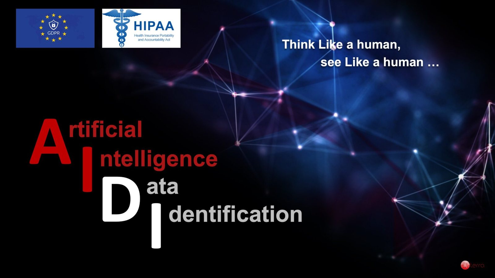</figure><figure>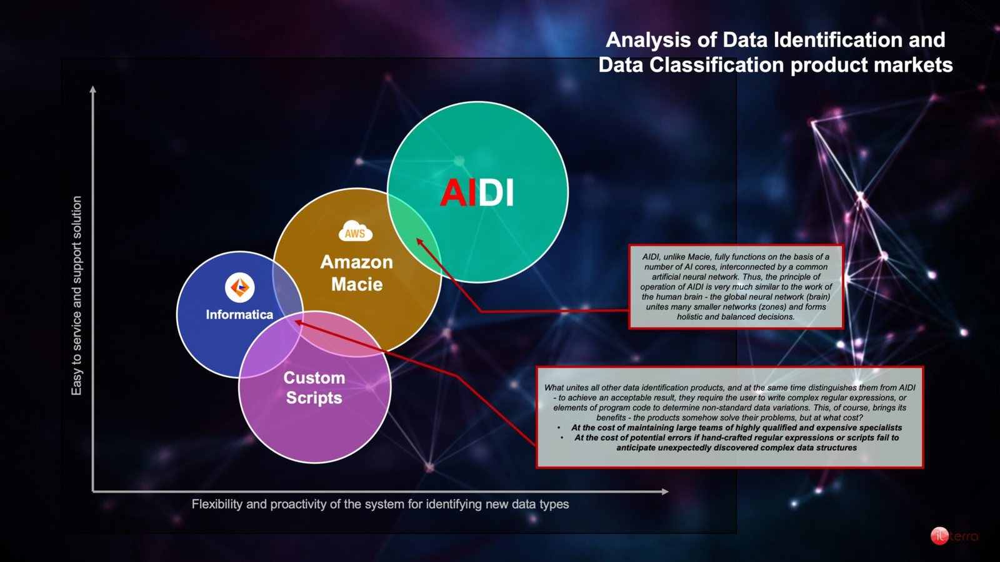</figure><figure>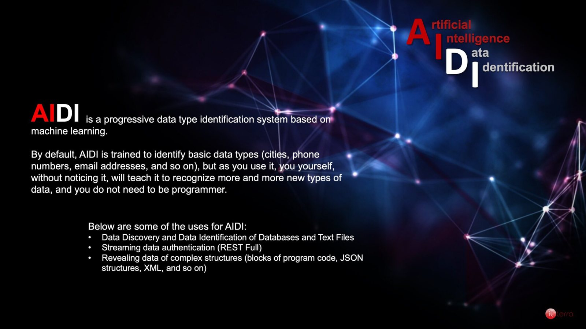</figure><figure>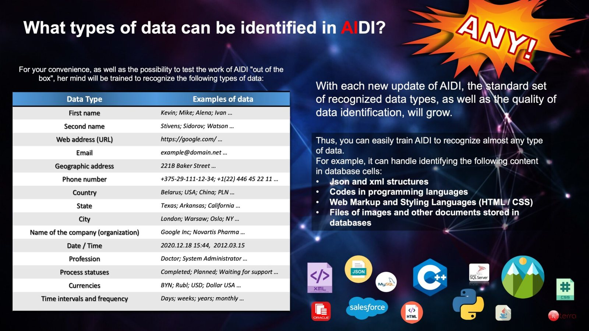</figure><figure>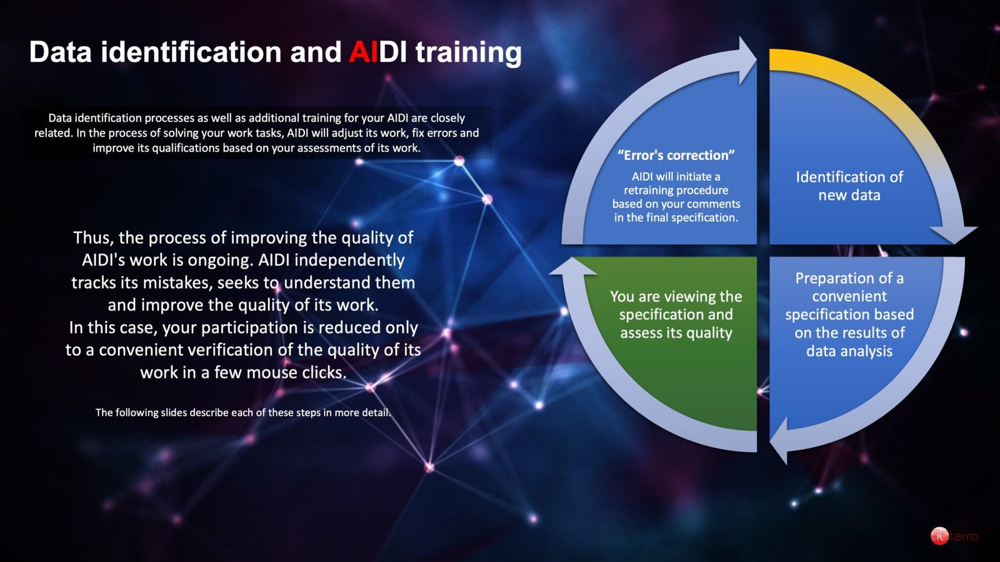</figure><figure>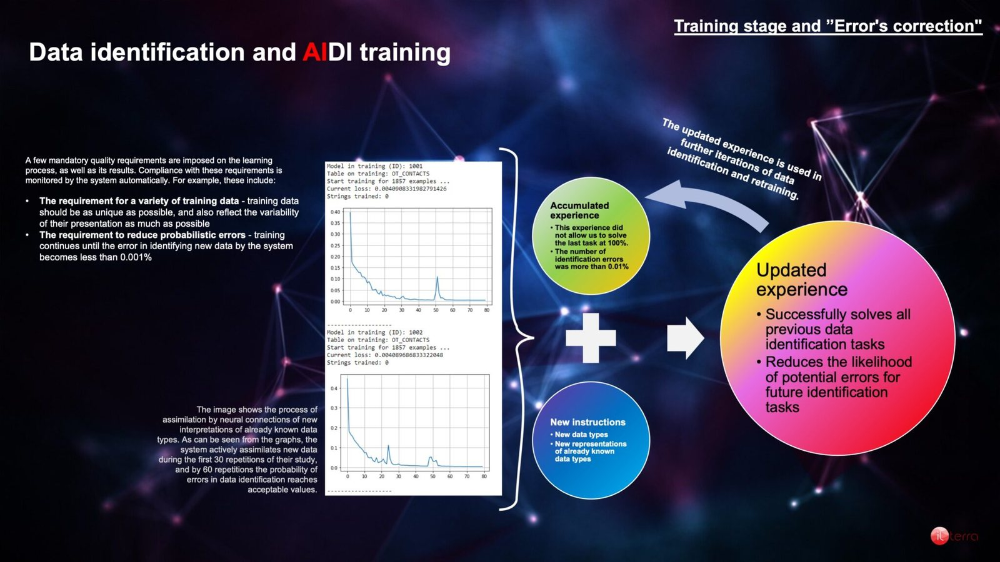</figure><figure>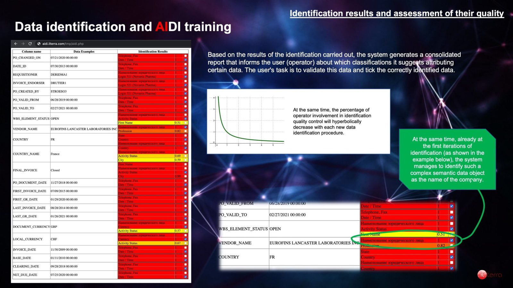</figure><figure>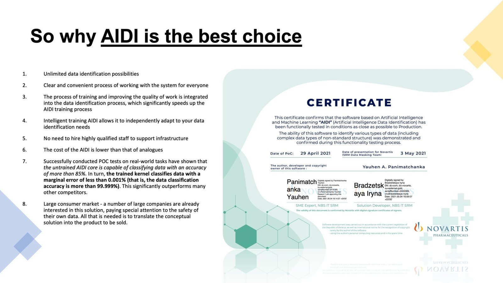</figure><figure></figure><figure></figure><figure>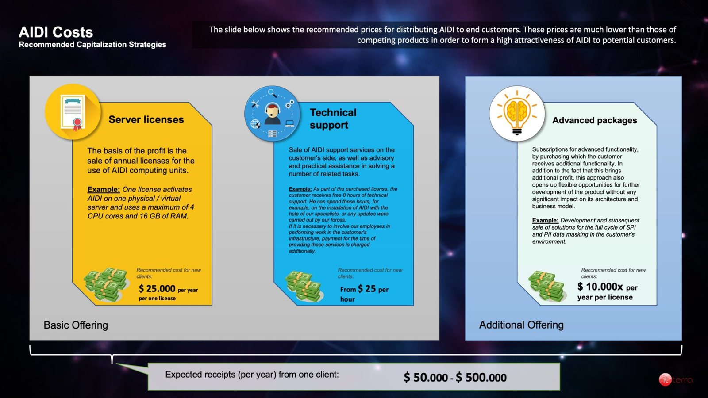</figure><figure></figure>

By default, AIDI is trained to identify basic data types (cities, phone numbers, email addresses, and so on), but as you use it, you yourself, without noticing it, will teach it to recognize more and more new types of data, and you do not need to be programmer.

Below are some of the uses for AIDI:

- Data Discovery and Data Identification of Databases and Text Files
- Streaming data authentication (REST Full)
- Revealing data of complex structures (blocks of program code, JSON structures, XML, and so on)

## What types of data can be identified in AIDI?

| **Data Type** | **Examples of data** |
| --- | --- |
| First name | *Kevin; Mike; Alena; Ivan …* |
| Second name | *Stivens**;* *Sidorov**; Watson …* |
| Web address (URL) | *https://google.com/ …* |
| Email | *example@domain.net* *…* |
| Geographic address | *221B Baker Street …* |
| Phone number | *+375-29-111-12-34; +1(22) 446 45 22 11 …* |
| Country | *Belarus; USA; China; PLN …* |
| State | *Texas;* *Arkansas; California …* |
| City | *London; Warsaw; Oslo; NY …* |
| Name of the company (organization) | *Google Inc; Novartis Pharma …* |
| Date / Time | *2020.12.18 15:44,  2012.03.15* |
| Profession | *Doctor; System Administrator …* |
| Process statuses | *Completed; Planned; Waiting for support …* |
| Currencies | *BYN;* *Rubl**; USD; Dollar USA …* |
| Time intervals and frequency | *Days; weeks; years; monthly …* |

For your convenience, as well as the possibility to test the work of AIDI “out of the box”, her mind will be trained to recognize the following types of data

With each new update of AIDI, the standard set of recognized data types, as well as the quality of data identification, will grow.

Thus, you can easily train AIDI to recognize almost any type of data.

For example, it can handle identifying the following content in database cells:

- **Json and xml structures**
- **Codes in programming languages**
- **Web Markup and Styling Languages (HTML / CSS)**
- **Files of images and other documents stored in databases**

## Data identification and AIDI training

Data identification processes as well as additional training for your AIDI are closely related. In the process of solving your work tasks, AIDI will adjust its work, fix errors and improve its qualifications based on your assessments of its work.

Thus, the process of improving the quality of AIDI’s work is ongoing. AIDI independently tracks its mistakes, seeks to understand them and improve the quality of its work.

In this case, your participation is reduced only to a convenient verification of the quality of its work in a few mouse clicks.

<figure>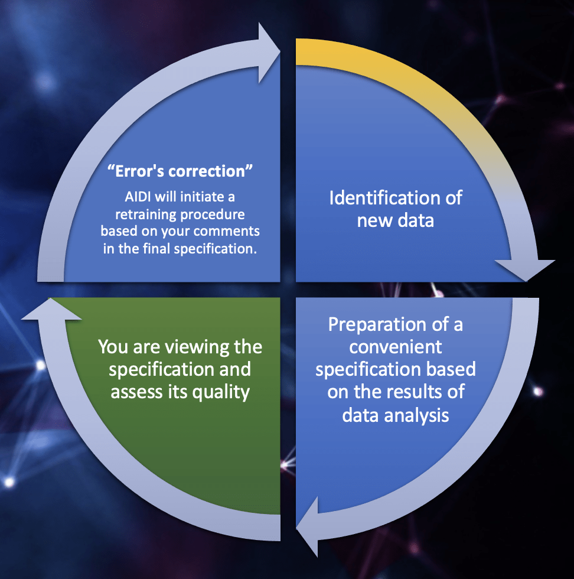</figure>

### Training stage and ”Error’s correction”

A few mandatory quality requirements are imposed on the learning process, as well as its results. Compliance with these requirements is monitored by the system automatically. For example, these include:

- **The requirement for a variety of training data** – training data should be as unique as possible, and also reflect the variability of their presentation as much as possible
- **The requirement to reduce probabilistic errors** – training continues until the error in identifying new data by the system becomes less than 0.001%

<figure>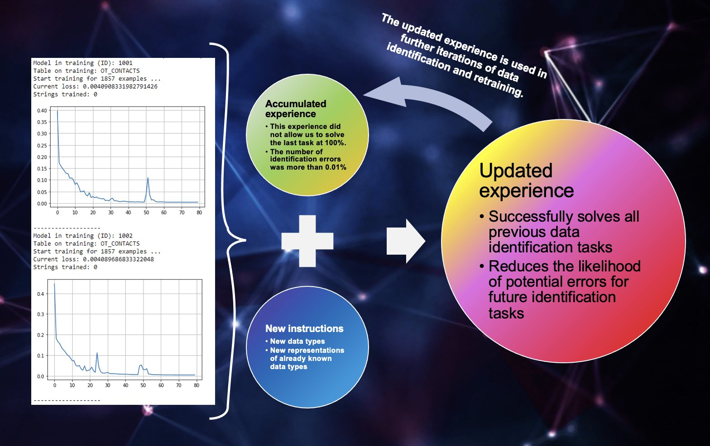</figure>

### Identification results and assessment of their quality

<figure>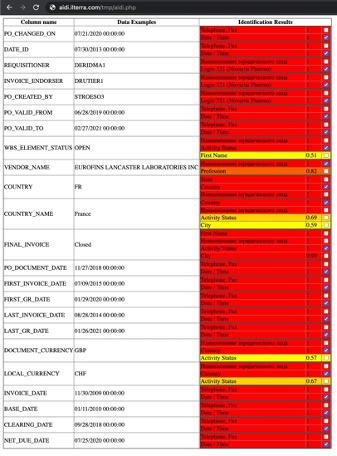</figure>

Based on the results of the identification carried out, the system generates a consolidated report that informs the user (operator) about which classifications it suggests attributing certain data. The user’s task is to validate this data and tick the correctly identified data.

<figure>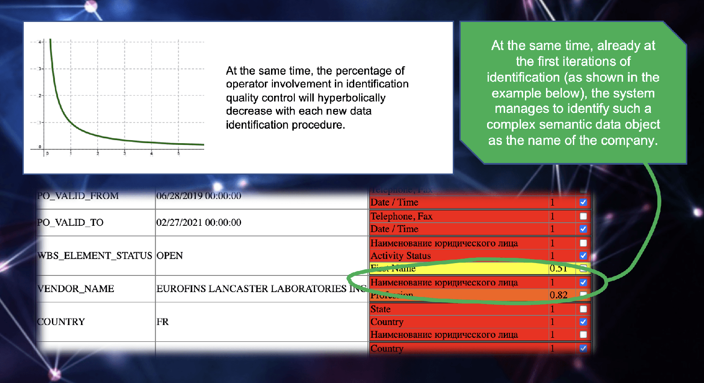</figure>

## So why AIDI is the best choice?

<figure class="figure">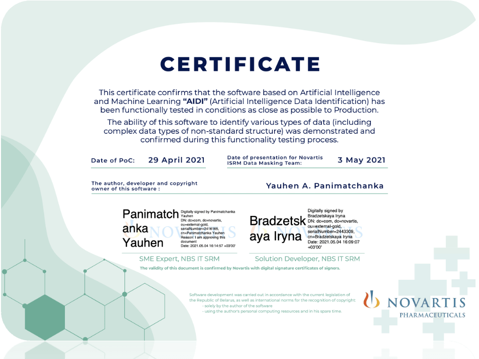</figure>

1. Unlimited data identification possibilities
2. Clear and convenient process of working with the system for everyone
3. The process of training and improving the quality of work is integrated into the data identification process, which significantly speeds up the AIDI training process
4. Intelligent training AIDI allows it to independently adapt to your data identification needs
5. No need to hire highly qualified staff to support infrastructure
6. The cost of the AIDI is lower than that of analogues
7. Successfully conducted POC tests on real-world tasks have shown that *the untrained AIDI core is capable of classifying data with an accuracy of more than 85%.* In turn, **the trained kernel classifies data with a marginal error of less than 0.001% (that is, the data classification accuracy is more than 99.999%)**. This significantly outperforms many other competitors.
8. Large consumer market – a number of large companies are already interested in this solution, paying special attention to the safety of their own data. All that is needed is to translate the conceptual solution into the product to be sold.

## Download AIDI Full Presentation

[English version](aidi-presentation-en.pdf)

[Русская версия](aidi-presentation-ru.pdf)

**Still have questions?  
Or maybe you are already interested in using this product or investing in it?**  
Then contact us at this email address: [info@ilterra.com](mailto:info@ilterra.com)
