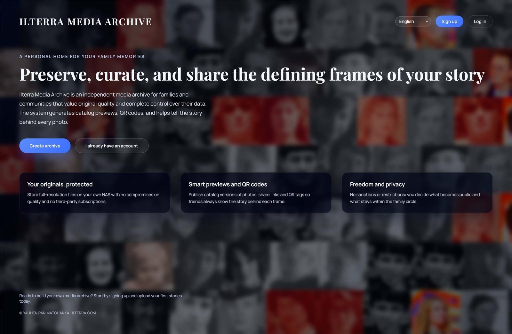
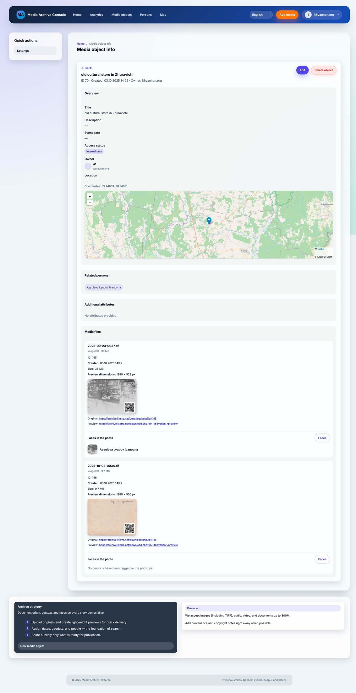
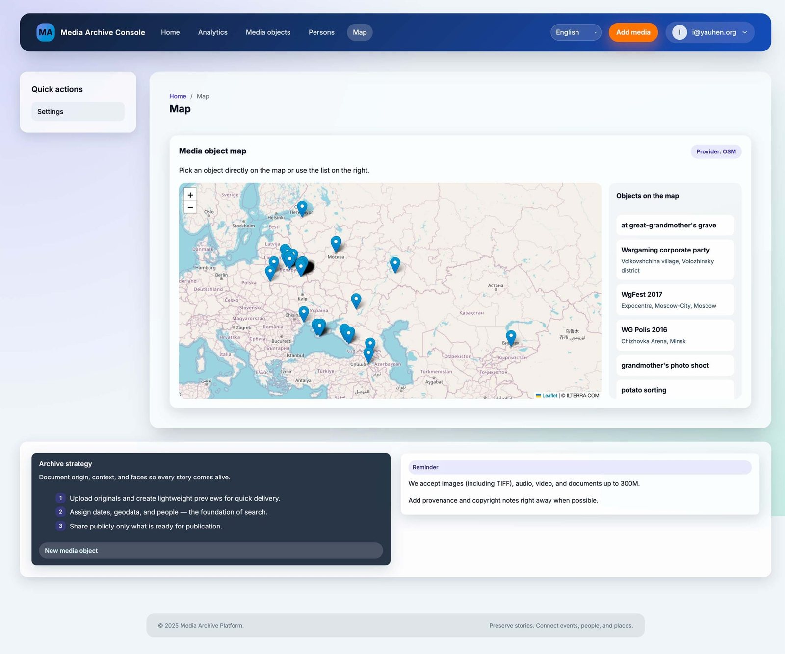
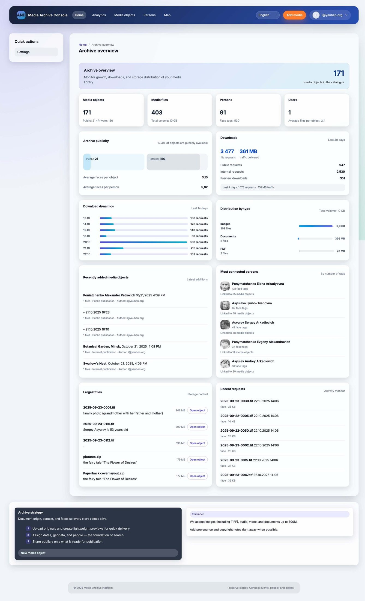

## Vision

**ilTerra Media Archive** is a self-hosted web application built to preserve the visual and emotional history of families, communities, and creative teams.  
It transforms scattered photos, documents, and videos into a searchable, people-centric digital archive — one that lives safely on your own server, under your full control.

---

### keep full-resolution originals, full control, and full context — forever

<a class="btn btn-outline" href="https://archive.ilterra.net" target="_blank" rel="noopener">Explore</a>

## The Problem It Solves

Modern cloud storage was built for convenience, not heritage.  
It compresses, renames, and flattens files into endless folders — erasing the context of *who*, *where*, and *why* behind every image.  
Subscription prices grow each year, and “unlimited” plans quietly disappear.

For families digitising old photos or institutions managing terabytes of archival material, this model becomes both costly and fragile.  
Cloud providers may throttle, compress, or even restrict access due to political sanctions or regional policies — as seen again in **October 2025**, when a global AWS outage locked millions of users out of their data.

Meanwhile, most people already own what clouds charge them for:  
a home server or NAS with RAID protection and redundant drives.  
Hosting your archive there — with encrypted online access — is often cheaper, faster, and safer than renting someone else’s disk.

That’s the philosophy behind **ilTerra Media Archive**:  
keep full-resolution originals, full control, and full context — forever.

<a class="btn btn-outline" href="https://archive.ilterra.com" target="_blank" rel="noopener">Visit MEDIA ARCHIVE</a>

<figure class="figure"></figure>

---

## How It Works

<figure class="figure"></figure>

### Objects, not just files

Each “Media Object” can include multiple files — for example, the front and back of a photograph, or a video with its ticket scan.  
Shared metadata (date, place, people) ties them into one story.

### People, places, and time {: .text-right }

Tag faces, link them to person profiles, and visualise everything on an interactive map.  
Over time, your archive becomes a living web of people and memories.
{: .text-right }

<figure class="figure"></figure>

- **Public view, private originals.**  
  Publish lightweight previews or QR-tagged catalog pages, while keeping full-quality originals safely behind access controls.
- **Smartphone offload.**  
  Free up mobile storage by exporting valued photos and videos directly to your private archive — without compression, subscriptions, or risk of account lockout.

---

## Why It’s Different

**📷 No compression, no compromise**  
Store high-resolution TIFFs, RAW files, or scans without quality loss.  
Nothing is altered, re-encoded, or “optimised” behind your back.

**🗺 Meaningful organisation**  
The system understands relationships — people, events, locations, time — turning flat folders into interconnected stories.

**🔐 Your data, your rules**  
Run it on your own hardware or trusted host.  
No recurring fees, no geographic restrictions, no vendor lock-in.

**🛡 Resilient by design**  
Clouds fail too. When you own your infrastructure, you control how and where backups are made — even offline.

<figure class="figure"></figure>

---

Example Use Cases
{: .text-center .text-large }

- **Family heritage.** Preserve generations of photos, letters, and home videos.
- **Cultural institutions.** Catalogue historical collections for research and exhibitions.
- **Researchers & journalists.** Store field media with precise geotags and annotations.
- **Creative studios.** Organise project assets with private collaboration spaces.

---

### Security & Technology

- User authentication and roles.
- MFA and secure download tokens.
- Optional public previews with QR codes.
- Geospatial map search.
- Local or remote hosting on any standard LAMP stack.

---

### Summary

**ilTerra Media Archive** preserves origin, context, and people —  
so every photo remains not just a file, but a story with a face, a place, and a moment in time.

---

### Next Step

> **Interested in exploring ilTerra Media Archive?**  
> [ **Book a Demo Session** ]  [ **Acquire Solution with Source Code & Rights** ]
