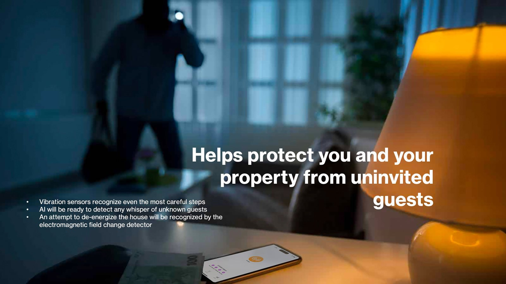
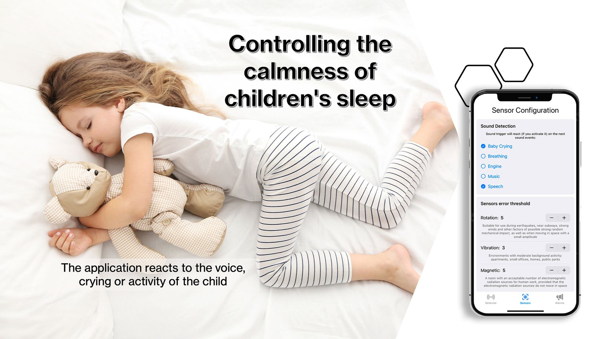
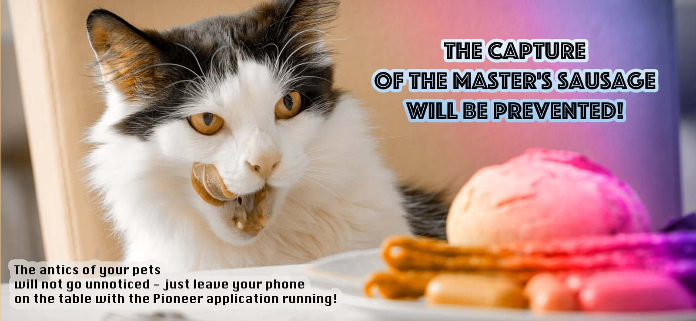

A mobile application for devices based on [iOS](/tag/ios/) operating systems that solves the problems of automated monitoring of the surrounding space.

The application is able to solve many problems from completely different areas of life and activity, for example::

- protection of territory and property
- child control (a kind of analogue of a babysitter radio)
- pet control

## Territory and property protection

<figure class="figure wide"></figure>

The main tasks that the application can solve are related to the protection of territories, property and personnel. At the same time, the specific purposes for which the application can be applied can be both civil and military (in the case of the use of the application by members of the armed forces). At the same time, the application developer does not in any way encourage the use of the application for one purpose or another, but only demonstrates its potential.

**Examples of civilian tasks:**

- ***Protection of private property*** – By placing a smartphone running the application near valuables, you can control the presence of third parties in the vicinity. So, with the vibration exposure control settings set, the smartphone will notify you of someone approaching its location and thus it is possible to prevent the theft of your property.
- ***Security of temporarily left things in common areas*** – Probably each of you had to leave any of your personal belongings unattended on the beach while you went swimming. And many of you, instead of enjoying the unity with water, were worried about the safety of your things. But you would have had the Pioneer Trigger application with you then, and the experience would have become much less – a smartphone left in the depths of your bag would make a loud sound if someone even touched the bag with your things. And this sound would surely attract the attention of others, thereby scaring away the thief.

**Examples of military tasks:**

- ***Protecting the rear*** – Being in your own fortification, it is important to be sure that at any moment an enemy saboteur will not penetrate the fortification and cause irreparable damage to you. To reduce the risk of sudden entry, this application can also be used – it will allow you to raise an alarm in a timely manner by registering the presence of unauthorized persons.
- ***A new level of mine countermeasures*** – The current development of sapper engineering makes it easy to deal with almost all types of mines and infantry deterrence systems. But what if the mine is not just invisible, but also intelligent? What if it will be able to respond not only to direct physical impact, but also to identify the movement of the enemy both by sound and by scanning the electromagnetic field around it. Such a mine is capable of reacting in advance not only to approaching armored vehicles, but also to the use of demining equipment – for example, various metal detectors. And in principle, any bodies, regardless of their physical parameters, will be recognized to a certain extent by such a system at a distance from it without direct visual or mechanical contact.

## Child control

Nothing is more important than the sound sleep of their little child for a parent at night, and therefore some parents are forced to spend a lot of time at night sitting next to their sleeping children in a state of readiness to respond to their crying, the demand for food or changing diapers. In order to give parents a chance to get some sleep in their cozy beds, humanity has come up with a simple device – a babysitter radio. In fact, this is a walkie-talkie that transmits sound from the crib where the child sleeps to the parent, and allows him to control the child.

<figure class="figure wide"></figure>

But what if the child woke up, what if the child performs some active actions quietly, without screams and calls from the parent (for example, he secretly tries to get out of the crib 🙂 )?

In this case, Pioneer Trigger can again be useful. He is able to both respond to the crying of the child, and to the manifestation of excessive activity by him. And by setting up notifications via WebHook instead of a sound notification, you will receive a message and at the same time your child will not be frightened by incomprehensible sounds.

## Pet control

Sometimes pets try to take power in the house in their furry paws. And here dogs and cats have one thing in common – they try to do it when no one sees them: dogs try to throw the world into turmoil and chaos by throwing things around the house in every possible way, and cats will definitely try to eat your delicious breakfast, or lick all the dishes left after it.

<figure class="figure wide"></figure>

If you want their antics not to go unnoticed, and most importantly, to make your pets understand that somehow they remain under your control even when you are away – use this application 😉

## FAQ

**How exactly does the app control the environment?**

To control the space, the application uses all the main sensor modules of your smartphone or tablet, and using them registers various physical and energy characteristics. Any body or object that appears in the scanning area of the application somehow makes a change in the surrounding space and the application registers these changes.

**How exactly does the application notify you of a trigger?**

At the moment, when triggered, the application is able to both play one of the sounds of your choice, and send a web request to the address specified by the user (conditionally to the user’s server responsible for registering such triggers).

**Where can I download the application?**

You can download the application from the Apple AppStore using the links below:

<figure class="figure text-center"></figure>
