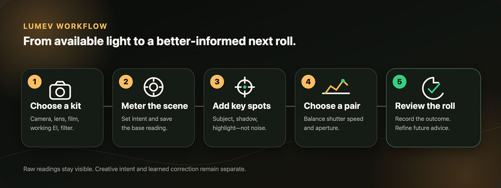
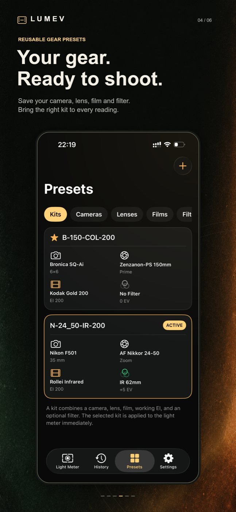
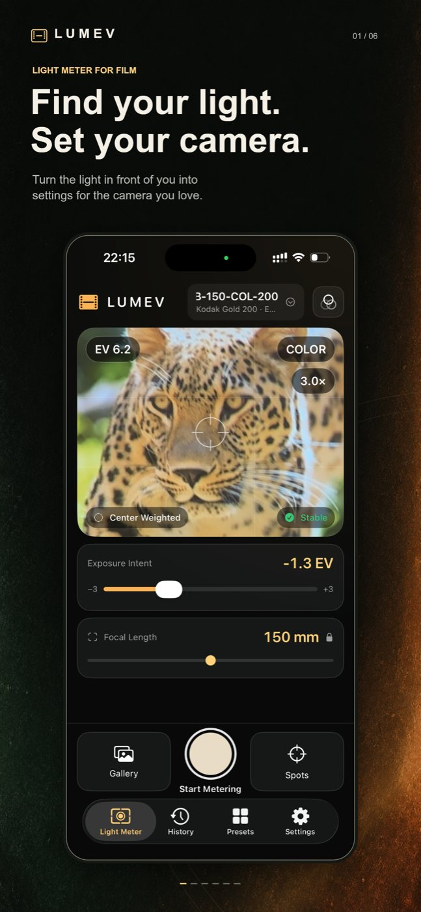
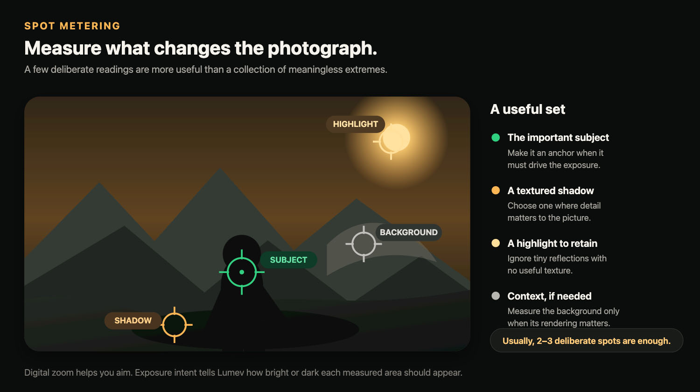
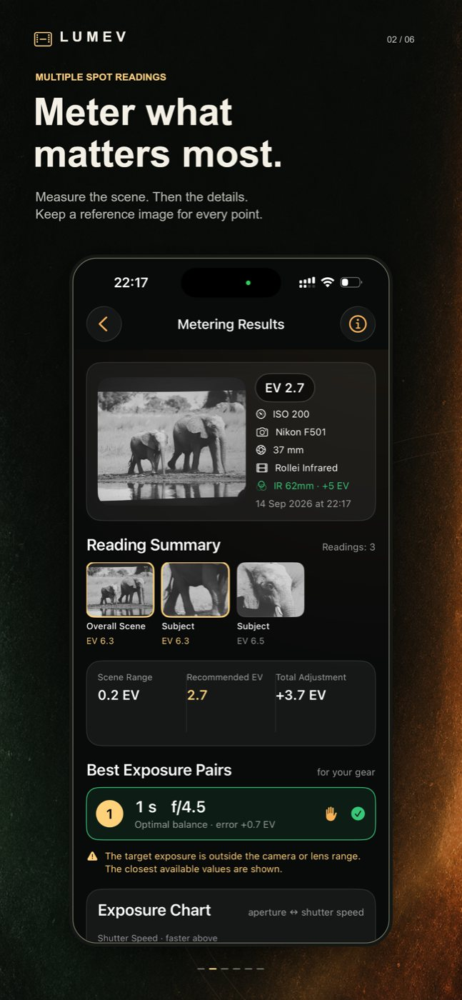
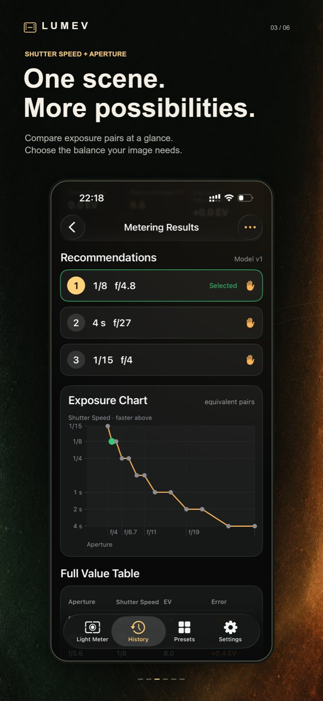
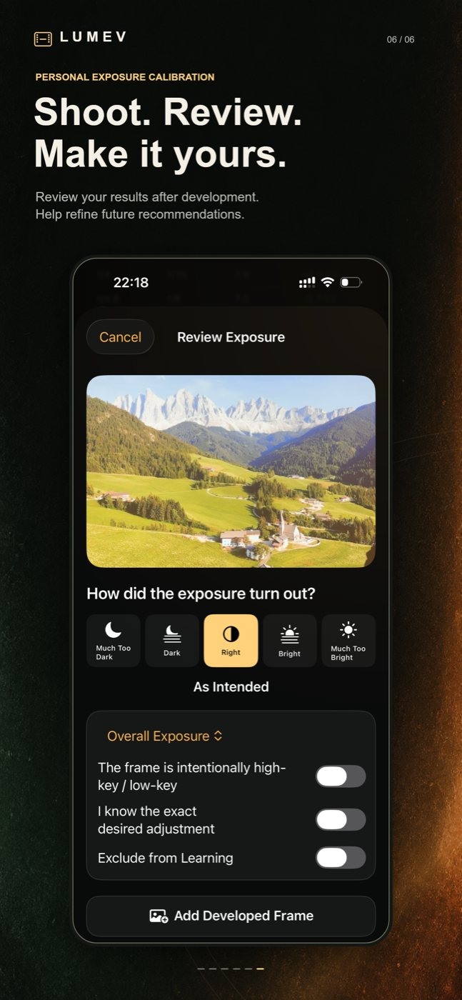

Lumev helps you turn a reflected-light reading from your phone into settings for a real film camera. This guide covers the complete workflow: build a kit, meter the scene, add important spot readings, choose an exposure pair, and review the photograph after development.

The 60-second version

Select a kit → frame the scene → set Exposure Intent if needed → tap **Start Metering** → calculate immediately or add live spot readings → choose a shutter/aperture pair → confirm what you actually used → review the result after development.

<figure class="figure"></figure>

---

## 1. Build a kit before you shoot

A **kit** is a reusable combination of a camera, lens, film, working EI, and optional filter. It tells Lumev which settings exist on the equipment in your hands.

Open **Presets** and create or edit the individual items first:

### Camera

Add the shutter speeds available on the physical camera and choose its step size. Lumev uses this list rather than inventing a mathematically perfect speed that your shutter dial cannot set.

### Lens

For a prime lens, enter its focal length, widest aperture, smallest aperture, and aperture step. For a zoom lens, enter the focal range and, when applicable, the changing maximum aperture across that range.

The widest aperture is sometimes called the lens “speed.” It defines what the lens can be set to; any repeatable difference between nominal f-number and actual transmission should be handled cautiously through calibration, not guessed during every reading.

### Film and working EI

Store the film’s nominal or box ISO in its film profile. Set the **working EI** in the kit when you intentionally rate that film differently. For example, a box-speed ISO 400 film may be metered at EI 200 as part of a deliberate exposure and development workflow.

Choose the correct film type. When black-and-white film is active, Lumev can show the live preview in monochrome. This is a composition aid; the underlying metering data remains photometric.

### Filter

Add an optical filter with its diameter and light-loss correction. This is especially important for strong infrared, neutral-density, and color filters. Lumev keeps the correction visible and includes it in the calculation.

<figure class="figure text-center"></figure>

Finally, combine the items into a kit and make that kit active.

## 2. Prepare the meter

Return to **Light Meter** and check the active kit shown at the top of the screen. Tap it when you need to inspect the full configuration.

Before the reading:

1. Make sure the correct film and working EI are active.
2. Check whether an optical filter is enabled.
3. Set the focal length you are using, especially with a zoom lens.
4. Hold the phone in the same shooting position you intend to use for the photograph whenever practical.
5. Keep fingers and the phone case clear of the camera and clean the lens if the image is hazy.

The live EV value may move while the camera adapts. Wait for the **Stable** indicator before capturing a reading.

<figure class="figure"></figure>

## 3. Use Exposure Intent deliberately

The meter reading and your creative decision are not the same thing. **Exposure Intent** tells Lumev that you want this scene or subject rendered brighter or darker than a neutral reading.

- Move toward **+** when you deliberately want more exposure and a brighter rendering.
- Move toward **−** when you deliberately want less exposure and a darker rendering.
- Leave it at **0** when you want to start from the measured value.

Lumev stores raw measurement, creative intent, filter compensation, and learned correction separately. That separation lets you understand the recommendation later and prevents an intentional high-key or low-key choice from automatically being treated as a meter error.

## 4. Capture the base reading

Compose the frame, wait for a stable reading, then tap **Start Metering**. Lumev saves the overall-scene reference image, raw EV, creative intent, metering mode, active kit, focal length, and technical camera data available at that moment.

From the **Base Reading** screen you have two useful choices:

- **Calculate Exposure** for a straightforward scene where the general reading tells you enough.
- **Add Spot Readings** when a face, shadow, highlight, window, snow, or another area deserves separate attention.

The saved phone image is a reference, not a simulation of the final negative, scan, or print.

## 5. Add live spot readings when the scene is complex

Spot mode returns to a live camera preview with stronger digital zoom and a marked measuring area. Stay in the original shooting position as closely as possible, then aim the center marker at the part of the real scene you want to measure.

Digital zoom is an aiming aid. Lumev measures the corresponding region from the camera frame and saves what you saw as a separate reference image.

For each point you can:

- identify the area, such as Subject, Face, Shadow, Highlight, Sky, White, or Black;
- adjust its own Exposure Intent;
- include or exclude it from the combined calculation;
- give it more or less weight;
- make it the anchor when that subject must drive the exposure.

Capture the point, aim at the next important area, and repeat. You rarely need many readings. Two or three well-chosen points are usually more informative than measuring every object in the frame.

<figure class="figure text-center"></figure>

### What should I meter?

- **Portrait:** the face or skin, plus a highlight or deep shadow you care about retaining.
- **Backlit subject:** the important subject and the bright background separately.
- **Landscape:** a meaningful midtone, a textured shadow, and the brightest highlight whose detail matters.
- **Snow or a white wall:** meter it, then use positive intent if you want it to remain visibly bright rather than neutral gray.
- **Dark clothing or a black object:** use negative intent if it should remain dark rather than neutral gray.

Do not let a tiny specular reflection or an unimportant black gap control the exposure just because it is the brightest or darkest thing visible.

## 6. Choose how multiple readings are combined

Lumev can interpret the same set of points in different ways:

- **Base Priority** keeps the overall scene as the main reading and uses spots to reveal the range.
- **Average** combines only the readings you included.
- **Weighted Average** lets the important subject contribute more than secondary areas.
- **Anchor / Subject Priority** builds the result around one selected point.

There is no universally correct strategy. For a portrait, an anchored face reading may be clearer than an average of face, sky, and deep shadow. For an evenly lit scene, the base reading may already be sufficient.

When finished, tap **Finish Measurements**.

## 7. Read the result screen

The result screen keeps the measurement understandable:

- **Reading Summary** shows the overall scene and every spot with its own thumbnail and EV.
- **Scene Range** is the difference between the darkest and brightest measured areas, expressed in stops.
- **Recommended EV** is the effective target used to generate settings.
- **Total Adjustment** combines relevant corrections while the details remain available in the explanation view.
- **Best Exposure Pairs** ranks practical combinations for the selected gear.
- **Exposure Chart** shows equivalent pairs with real aperture and shutter-speed labels.
- **Full Value Table** lists every available pair and its small rounding error from the target.

<figure class="figure"></figure>

<figure class="figure"></figure>

### How to choose a pair

Equivalent pairs deliver approximately the same exposure, but not the same photograph:

- choose a **faster shutter** to reduce camera shake or subject motion;
- choose a **smaller aperture** (larger f-number) for more depth of field;
- choose a **wider aperture** (smaller f-number) when light is limited or shallow depth of field is intentional;
- use a tripod or another support when the handheld warning appears and the scene allows it.

The green selection is a recommendation, not a command. Choose the pair that serves the photograph.

## 8. Record what you actually used

Before leaving the result, confirm the shutter speed, aperture, and EI actually set on the film camera. If you followed the recommendation exactly, use the shortcut. If you changed the setting, record the real values.

This matters because later learning must compare the developed result with the exposure that reached the film — not merely with the app’s original suggestion.

## 9. Review after development

Open **History**, choose the exposure, and select **Review Exposure**. You may attach a scan, a photograph of the print, or another developed-frame reference. Then rate the result:

- Much Too Dark
- Dark
- Right / As Intended
- Bright
- Much Too Bright

Use the additional controls when relevant:

- mark an intentionally high-key or low-key frame so the creative decision is not mistaken for a technical error;
- enter an exact desired EV adjustment if you know it;
- exclude the record from learning if the shutter misfired, development went wrong, the scan is misleading, or another anomaly makes it poor evidence.

<figure class="figure"></figure>

## 10. How adaptive calibration works

Lumev does not replace metering with an opaque decision. It keeps the raw reading and applies learned correction as a separate, inspectable layer.

Learning is conservative:

- one rating cannot materially recalibrate the entire app;
- repeated and consistent results matter more than an isolated frame;
- several frames from one roll are not treated as completely independent experiments;
- confirmed actual settings and precise feedback carry more useful evidence;
- intentional looks and excluded records do not become accidental technical bias;
- older history is preserved exactly as it was at capture time.

In **Settings**, you can inspect calibration status, disable adaptive correction, reset the learned model without deleting exposure history, or export calibration data where the build provides that option.

---

## Privacy and local storage

Lumev performs its core camera processing, metering, calculations, history, and adaptive calibration locally. No Lumev account is required, and your reference images, presets, readings, and feedback are not automatically sent to ILTERRA.

Local app data can still be affected by deleting the app, losing or damaging the device, operating-system behavior, or backup settings. Maintain the device and backups appropriate for material you do not want to lose. Read the full [Lumev Privacy Policy](https://policies.ilterra.com/lumev/) for details.

## Troubleshooting

### The EV value keeps moving

Give the phone camera a moment to settle, avoid covering the lens, and wait for the Stable indicator. Flickering artificial light, moving subjects, and rapidly changing illumination can keep a reading in motion.

### The result looks several stops away from expectation

Check the active working EI and filter first. A strong filter can add a large correction. Then verify Exposure Intent, learned calibration, and the actual kit selected at the top of the meter.

### The preview is black or frozen

Confirm Camera permission in system settings, return to Lumev, and reopen the meter. If another app is actively using the camera, close it and try again.

### Black-and-white film still has color photometric data

That is expected. The monochrome preview helps composition, but the meter continues to analyze luminance rather than applying a decorative film simulation to the calculation.

### A recommended value is not on my camera

Edit the camera’s shutter-speed list and the lens aperture range/step in Presets. Lumev can only quantize correctly when the profile matches the physical controls.

### My developed scan looks brighter than the negative exposure suggests

Lab scanning, auto-levels, inversion, printing, and editing can change apparent brightness. Rate the underlying exposure with that processing in mind, or exclude the frame from learning if the scan is not reliable evidence.

---

[**Download Lumev on the App Store**](https://apps.apple.com/pl/app/lumev/id6811614331) · Android version coming soon
{: .text-center }
