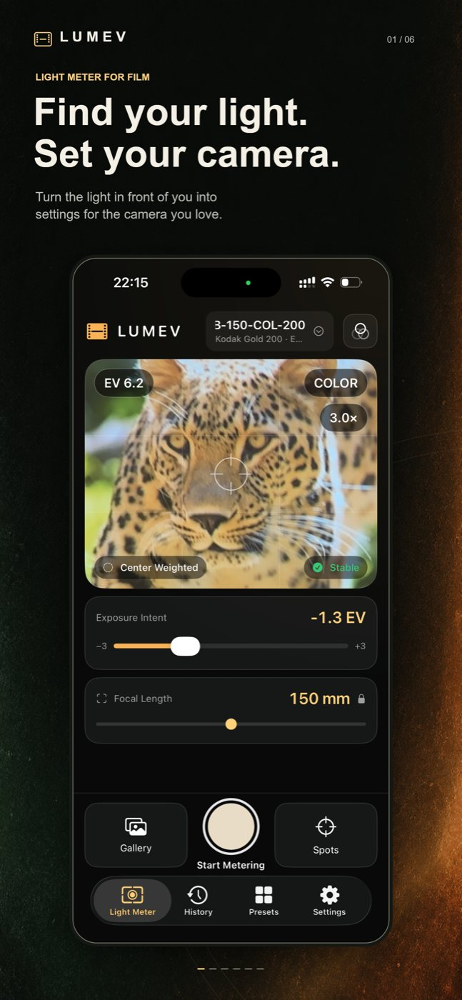
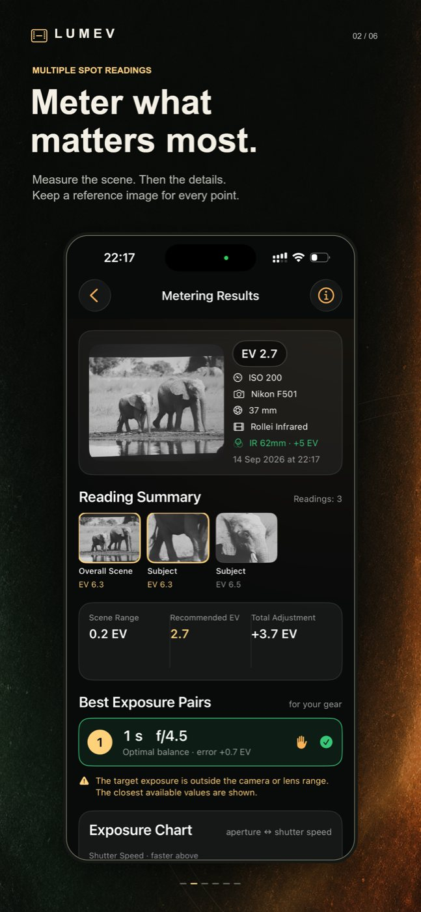
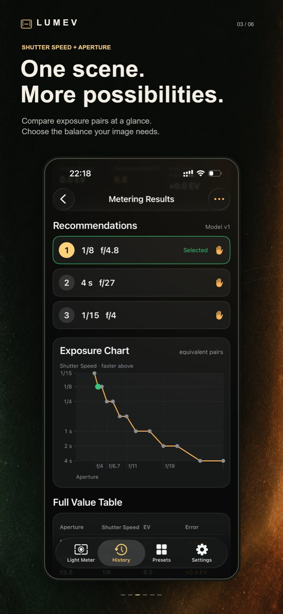
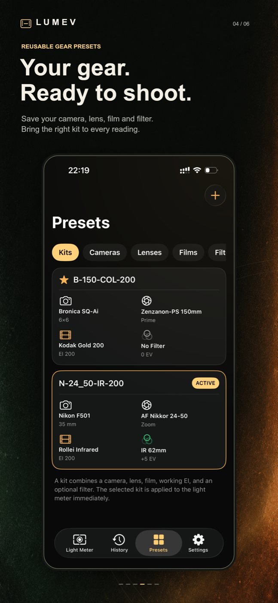
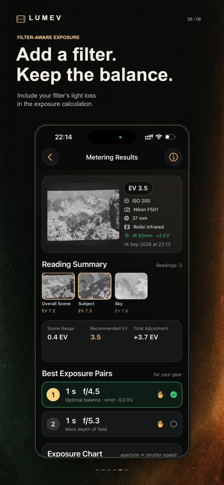
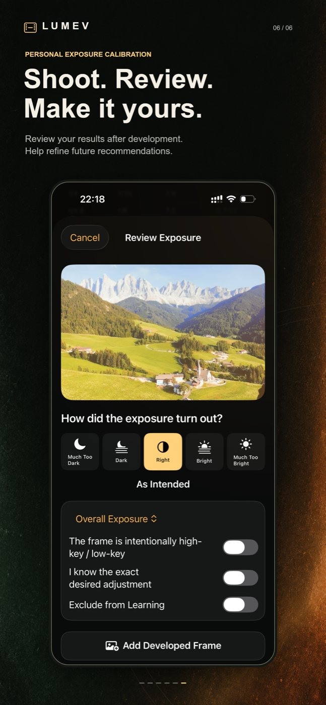
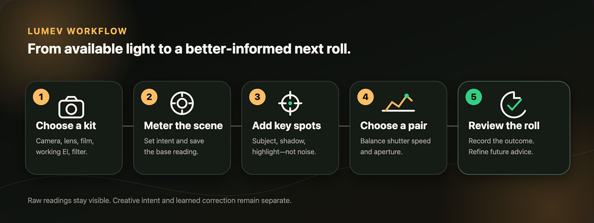

## Find your light. Set your camera.

Lumev is a focused smart light meter for film photography. Point your iPhone at the scene, measure the areas that matter, and get shutter-speed and aperture combinations your real camera and lens can actually use.

No account. No ads. No distracting feed. Just a clear path from the light in front of you to the settings on your film camera.

<figure class="figure text-center wide"></figure>

<figure class="figure"></figure>

<figure class="figure"></figure>

## A light meter that remembers the photograph

A single average is not always enough. A portrait can contain a bright window, a face in soft light, and deep shadow — all at once. Lumev begins with the whole scene, then lets you take live spot readings of the subject, shadows, highlights, or any other area you care about.

Each reading keeps its own reference frame. Later, you can see exactly what you measured and why you chose that exposure.

---

## One scene. More useful choices.

Lumev does not stop at a single abstract number. It translates the reading into equivalent shutter-speed and aperture pairs, quantized to the controls available on your equipment.

<figure class="figure"></figure>

Choose a balanced setting, protect against camera shake with a faster shutter, or stop down for more depth of field. The exposure chart and full value table make the trade-off visible instead of hiding it behind a vague scale.

## Built around your real kit

Create reusable presets for the combinations you actually carry:

- film camera and its available shutter speeds;
- prime or zoom lens, focal length, and aperture range;
- film stock, box speed, and working EI;
- optional optical filter and its light loss.

<figure class="figure"></figure>

Select a kit once and Lumev applies it to the meter immediately. Recommendations stay inside the limits of that camera and lens, and handheld warnings reflect the focal length you selected.

## Filters are part of the exposure, not an afterthought

An infrared, neutral-density, or color filter can cost several stops of light. Save filters in your collection and attach one to a kit or enable it for the current session. Lumev keeps the filter correction visible and includes it in the final recommendation, so it is harder to forget when the film is already loaded.

<figure class="figure"></figure>

## Learn from the roll you actually developed

The result is where film photography teaches you the most. Lumev saves the reference scene, recommendation, and the settings you actually used. After development, open the record, add a scan or photograph if you wish, and rate the exposure.

<figure class="figure"></figure>

Repeated, consistent feedback can refine future recommendations for your equipment and preferences. Learning is deliberately conservative: one unusual frame will not suddenly recalibrate the app, and historical readings are never rewritten.

---

## Clear enough for a first roll. Detailed enough to keep using.

If you are new to manual exposure, Lumev turns EV into settings you can dial directly into a camera. The interface explains what was measured and offers several practical choices.

If you already think in stops, Lumev keeps the useful detail available: raw readings, creative intent, scene range, equipment limits, filter compensation, learned correction, exposure error, and the exact settings used.

<figure class="figure"></figure>

## Designed for the quiet part of photography

- Live reflected-light metering through the iPhone camera
- Whole-scene, center-weighted, and spot-based workflows
- Digital zoom for precise spot aiming
- Monochrome preview when a black-and-white film is selected
- Multiple practical shutter/aperture recommendations
- Exposure history with scene and spot reference frames
- Adaptive personal calibration from post-development feedback
- Local, offline operation for core features
- No account, advertising, or promotional interruptions

Your camera frames, presets, readings, history, and calibration data stay in the app’s private storage on your device. Lumev does not operate an account or developer-controlled cloud service and does not automatically upload this content.

## Start with the scene in front of you {: .text-center }

Lumev is available now for iPhone and iPad. It requires iOS 17 or later. The Android version is in development.

<figure class="figure text-center wide"></figure>

## Need help?

- [Read the Lumev User Guide](/products/lumev/how-to-use-lumev-film-light-meter-guide/)
- [Lumev Privacy Policy](https://policies.ilterra.com/lumev/)

## Frequently asked questions

### Is Lumev an incident-light meter?

> No. Lumev uses the phone camera as a reflected-light meter: it measures light coming from the scene toward the phone. The angle and the area you point at therefore matter.

### Does Lumev take the film photograph?

> No. The images saved by Lumev are reference frames for remembering and reviewing a measurement. You still make the photograph with your analog camera.

### Why enter my camera and lens?

> Different cameras offer different shutter speeds, and lenses have different aperture and focal-length limits. A kit lets Lumev recommend combinations that are physically available on your equipment.

### Can I use a different EI from the film’s box speed?

> Yes. A film profile can keep its nominal ISO while a kit uses the working Exposure Index you intend to meter at.

### Does the app automatically judge my developed scan?

> No. Scanner auto-levels, lab corrections, inversion, printing, and editing can all change apparent brightness. You decide how the exposure turned out; an attached developed frame is visual context.

### Will one rating change every future recommendation?

> No. Adaptive calibration is intentionally conservative and looks for consistent evidence across more than one exposure and, where possible, more than one roll.

### Is my photography uploaded?

> No automatic upload is performed by Lumev. Core processing happens locally. Content leaves the app only when you deliberately use a system sharing or export feature, subject to the destination you choose.
