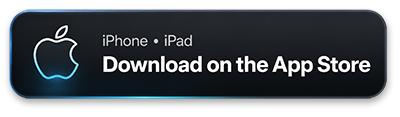
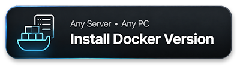
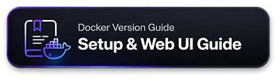
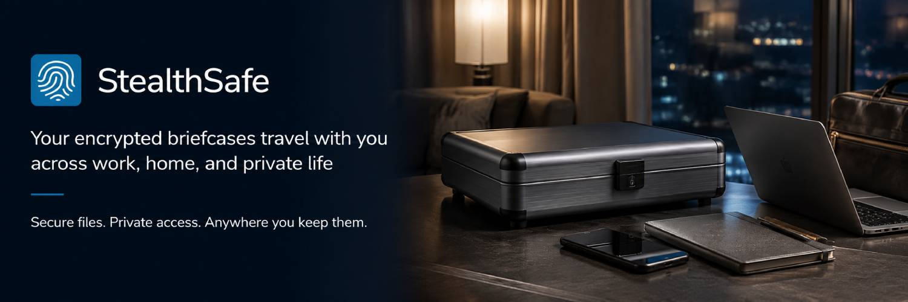
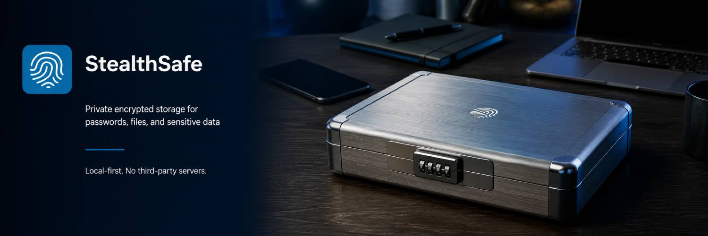
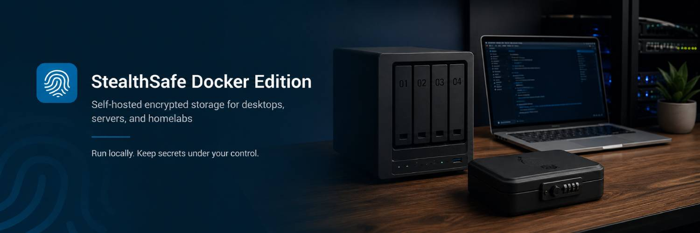

Encrypted briefcases for private data, passwords, documents, and operational secrets – now across Apple devices, desktops, and servers.

StealthSafe is a local-first secure data vault that lets you keep confidential information in encrypted briefcases. Use it on iPhone, iPad, and Apple Silicon Macs through the App Store, or run the Docker edition on almost any desktop operating system, workstation, private server, NAS, homelab, or infrastructure host that supports Docker.

With the Docker edition, StealthSafe is no longer only a mobile application. It becomes a cross-platform password and secret storage environment for personal use, professional workflows, and server-side automation.

<figure class="figure wide"></figure>

<figure></figure>

<figure class="figure wide"></figure>

Android support is planned next, so StealthSafe is moving toward full coverage of the most popular personal and professional operating systems.

> Screenshot placeholder: wide hero banner showing the StealthSafe app icon, the iOS/iPadOS interface, the web Docker interface on a desktop screen, and a small server/Docker visual cue. Add App Store and Docker download buttons under the headline.

## One Product, Many Environments

StealthSafe protects data in encrypted briefcases. A briefcase can contain folders, documents, fields, passwords, private notes, one-time codes, attachments, and other confidential records. The same SSBC2 briefcase format is used by the Apple app and the Docker edition, so your secure storage can move with you instead of being locked into one device.

Use StealthSafe where it fits your life and work:

- On iPhone and iPad for daily access to private information.
- On Apple Silicon Macs for a desktop-style experience with the App Store version.
- On Windows, macOS, and Linux through Docker.
- On private servers, NAS systems, homelabs, or internal infrastructure hosts that support Docker.
- In engineering environments where a local API can help internal tools read and write secrets through a controlled storage layer.

StealthSafe does not require a central vendor cloud. You decide where encrypted briefcases live: local folders, iCloud Drive, Google Drive, network folders, server-mounted storage, or other host locations that you expose to the application.

> Screenshot placeholder: comparison section with three panels – iPhone briefcase list, desktop web briefcase list, and Docker storage settings showing mounted folders.
>
> <figure class="figure"></figure>

## Why StealthSafe

### Local-first privacy

Your information is encrypted before it is stored. StealthSafe is designed around user-controlled storage, not around sending your private records to a developer-operated database.

### Multiple encrypted briefcases

Instead of keeping everything in a single vault, StealthSafe lets you organize information into separate encrypted briefcases. This is useful for personal life, work, projects, clients, infrastructure, travel, family records, and any other area where separation matters.

### Cross-platform compatibility

The Docker edition is compatible with StealthSafe SSBC2 briefcases used by StealthSafe iOS and macOS versions 2.0, 2.1, and 2.2. Newer versions may still open, but features introduced after 2.2 are not guaranteed until the Docker edition is updated.

### Works with storage you already use

StealthSafe can work with local directories, cloud-synchronized folders, removable drives, and server-mounted storage. If your operating system can mount a folder, the Docker edition can usually be configured to work with it.

### API-ready for advanced workflows

The Docker backend includes API documentation, making it possible to integrate StealthSafe into custom tools, internal dashboards, automation scripts, or server workflows. This allows engineers to centralize credential storage while keeping the encrypted briefcase model.

> Screenshot placeholder: browser view of the Docker edition API documentation at `/docs`, with a small caption: “API documentation for internal integrations.”
>
> <figure class="figure"></figure>

## Apple Edition

The Apple edition is available from the App Store and runs on iPhone, iPad, and Apple Silicon Macs. It is built for private, everyday access to encrypted briefcases, with a familiar mobile-first interface and storage options such as local device storage and iCloud Drive.

Download the official Apple version only from the App Store:

<figure class="figure wide"></figure>

> Screenshot placeholder: App Store product badge next to screenshots of the iPhone and iPad versions.

## Docker Edition

The Docker edition runs StealthSafe as two containers:

- A backend API container that works with encrypted SSBC2 briefcases.
- A frontend container that provides a modern web interface.

The installation package includes simple launcher scripts. If Docker is already installed, the scripts help configure which host folders should be mounted into StealthSafe, start the containers, and open the app in your browser.

This makes StealthSafe practical for:

- Personal desktop password and private document management.
- Power users who keep encrypted briefcases in cloud-synchronized folders.
- Engineers who want a private server-side secret storage layer.
- Teams that want to host the app inside their own trusted environment.
- Internal tools that need to manage confidential records through a documented API.

> Screenshot placeholder: Docker launcher terminal on the left and the web unlock screen on the right. Show the browser address `http://localhost:33330`.
>
> <figure class="figure"></figure>

## A Natural Fit For Individuals And Engineers

For personal users, StealthSafe is a secure place for private notes, credentials, documents, access records, recovery details, and other sensitive information. You can keep the storage local, synchronize encrypted files through a cloud folder, or back them up in your own way.

For engineers and administrators, the Docker edition adds another layer: StealthSafe can run close to the systems that need controlled access to secrets. Mount a server folder, configure storage locations, and use the API documentation to build integrations with your own tooling.

The result is one product family for both daily private use and more technical operational workflows.

> Screenshot placeholder: user-oriented example showing personal briefcases and engineer-oriented example showing project/server briefcases, without revealing real secrets.

## Security Model In Simple Terms

StealthSafe stores data in encrypted briefcases. The application can open a briefcase only when the active profile has the required cryptographic access. Briefcases can be copied, synchronized, backed up, or moved between supported environments while remaining encrypted at rest.

The Docker edition keeps the same core idea: the backend can only see host folders that you explicitly mount into the containers, and the app scans only storage folders selected inside the active profile.

## Availability

- iPhone and iPad: available on the App Store.
- Apple Silicon Mac: available through the App Store as the Apple app.
- Docker desktops and servers: available through the StealthSafe Docker installation package.
- Android: planned.

## Final Call To Action

Start with the device you already use. Install StealthSafe from the App Store for Apple devices, or use the Docker edition to bring encrypted briefcases to your desktop, server, NAS, or private infrastructure.

<figure class="figure wide"></figure>

<figure class="figure wide"></figure>

