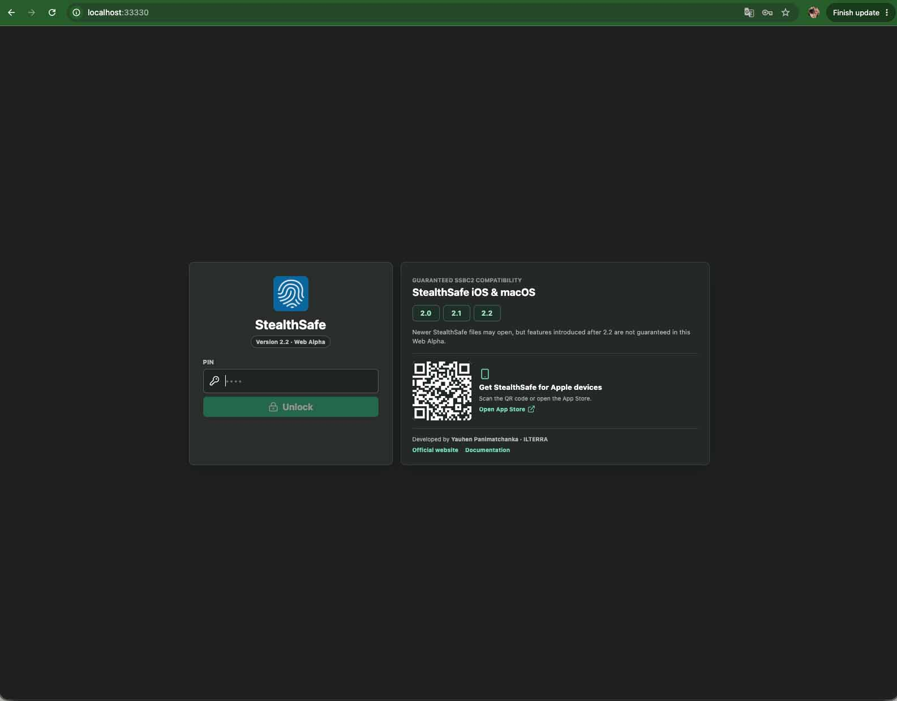
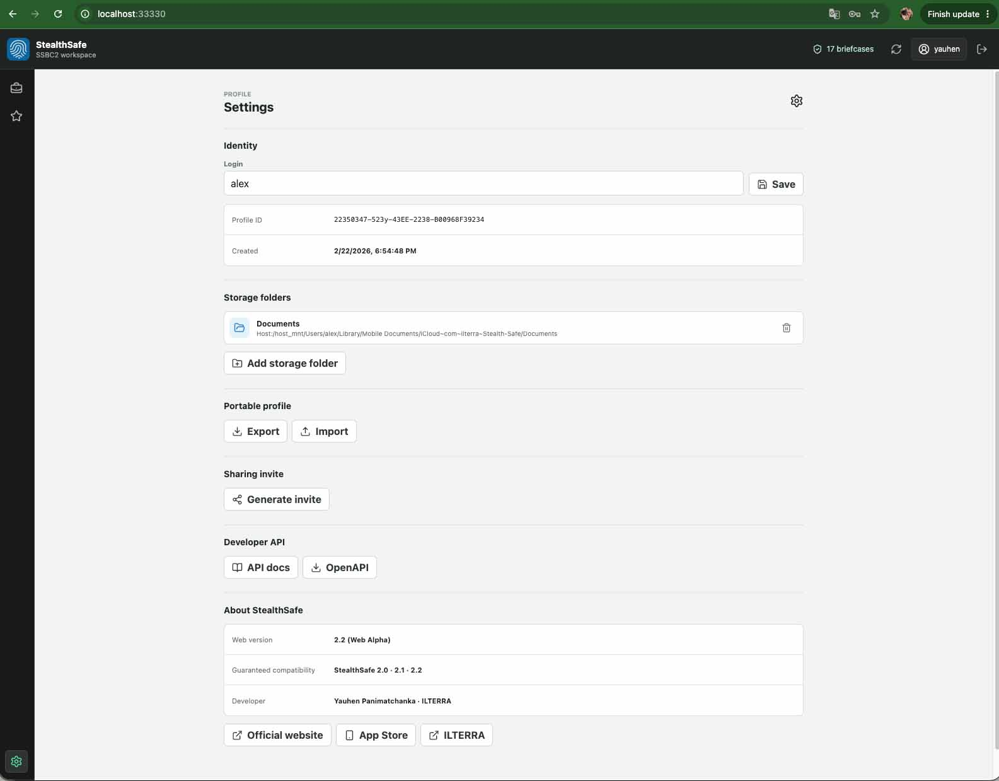
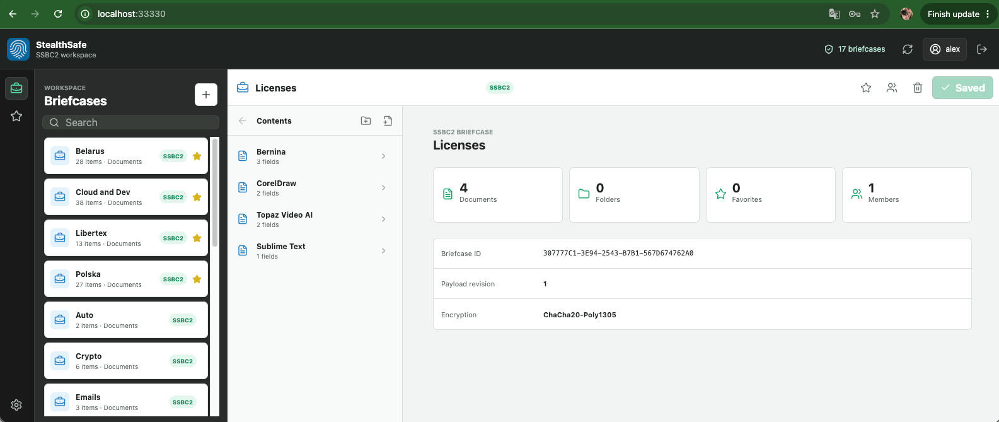

This guide explains how to install the StealthSafe Docker edition, configure host folder access, and start using encrypted SSBC2 briefcases from a desktop, workstation, private server, or NAS-like environment.

## What Docker Is

Docker is a container platform. Instead of installing every application dependency directly on your computer, Docker runs applications in isolated containers. StealthSafe Docker edition uses two containers:

- `backend`: the local API that reads and writes encrypted StealthSafe briefcases.
- `frontend`: the web interface that you open in a browser.

Install Docker Desktop from the official Docker website:

[Download Docker Desktop](https://www.docker.com/products/docker-desktop/)

On Linux servers, you can also install Docker Engine and Docker Compose through your distribution package manager or the official Docker documentation.

## Requirements

- Docker with Docker Compose support.
- A browser.
- The StealthSafe Docker installer package.
- At least one host folder that you want StealthSafe to use for encrypted briefcases.

## Download The StealthSafe Docker Package

Download the StealthSafe Docker package from the official ilTerra website or release page.

> [StealthSafe-2.3.1-build-8-installation](stealthsafe-2-3-1-build-8-installation.zip)

After downloading, unpack the archive. The folder should contain launch scripts such as:

- `start-stealthsafe.sh` for macOS and Linux.
- `start-stealthsafe-windows.bat` for Windows.
- `start-stealthsafe-production.sh` and `start-stealthsafe-production-windows.bat` for production Docker Hub images, if included in the package.

## Quick Start On macOS Or Linux

Open a terminal in the unpacked StealthSafe Docker folder and run:

```
chmod +x start-stealthsafe.sh
./start-stealthsafe.sh
```

The launcher will ask whether you want to change the default mounted path or add more paths.

The default Unix path is:

```
/
```

On macOS, Docker Desktop may not allow mounting the entire `/` filesystem unless that path is explicitly shared in Docker Desktop settings. For everyday use, it is often better to mount a narrower folder, such as your home directory, Documents folder, or a dedicated StealthSafe storage folder.

## Quick Start On Windows

Unpack the StealthSafe Docker package and run:

```
start-stealthsafe-windows.bat
```

You can double-click the BAT file or run it from Command Prompt / PowerShell.

The default Windows path is:

```
C:/
```

The launcher will ask whether you want to keep that default, replace it, or add more mounted paths.

## Open The Application

After the containers start, open:

```
http://localhost:33330
```

Enter your PIN. If a profile already exists for that PIN, StealthSafe opens it. If no profile exists yet, StealthSafe creates a new encrypted profile automatically. The user does not need to choose a separate “new profile” mode.

> <figure class="figure"></figure>

## How Host Folder Mounts Work

Docker containers cannot automatically see your whole computer. You decide which host folders should be visible inside StealthSafe.

The launcher stores mount configuration in environment files:

- macOS/Linux: `config/unix.env`
- Windows: `config/windows.env`

If you edit these files later, run the launcher again. It will recreate the containers with the updated mounts.

Example configuration:

```
STEALTHSAFE_MOUNT_COUNT=2
STEALTHSAFE_MOUNT_1_NAME=Host
STEALTHSAFE_MOUNT_1_PATH=/
STEALTHSAFE_MOUNT_2_NAME=Documents
STEALTHSAFE_MOUNT_2_PATH=/Users/alex/Documents/StealthSafe
```

Each mount has:

- A display name, such as `Documents` or `ServerStorage`.
- An absolute host path.

After unlock, open **Settings -> Storage folders** inside StealthSafe. There you select the exact nested folders where StealthSafe should scan for `.ssbc2` files and offer briefcase storage. Mounting a broad host folder only makes it available to the app; the active profile still needs selected storage folders.

> <figure class="figure"></figure>

## Mount Examples

### Dedicated Desktop Folder

macOS:

```
/Users/alex/Desktop/StealthSafe
```

Windows:

```
C:/Users/Alex/Desktop/StealthSafe
```

Linux:

```
/home/alex/Desktop/StealthSafe
```

This is a simple setup for testing or personal desktop use.

### Documents Folder

macOS:

```
/Users/alex/Documents/StealthSafe
```

Windows:

```
C:/Users/Alex/Documents/StealthSafe
```

Linux:

```
/home/alex/Documents/StealthSafe
```

This is a good default for long-term personal storage.

### iCloud Drive

On macOS, an iCloud Drive folder may look similar to:

```
/Users/alex/Library/Mobile Documents/com~apple~CloudDocs/StealthSafe
```

Make sure Docker Desktop is allowed to access this folder. Then add it as a mount and select it in StealthSafe settings.

### Google Drive

On macOS with Google Drive for desktop, a folder may look similar to:

```
/Users/alex/Library/CloudStorage/GoogleDrive-alex@example.com/My Drive/StealthSafe
```

On Windows, Google Drive may appear as a drive letter or local mounted path, for example:

```
G:/My Drive/StealthSafe
```

Exact paths depend on your Google Drive desktop settings.

### Samba, SMB, NAS, Or Other Network Storage

First mount the network folder on the host operating system. For example:

- macOS: `/Volumes/TeamStorage`
- Linux: `/mnt/team-storage`
- Windows: `Z:/TeamStorage`

Then add that mounted path to StealthSafe Docker configuration. StealthSafe does not need to know whether the folder is local, cloud-synchronized, or network-backed. It only needs the host path to be visible through Docker.

## Changing Mounted Folders Later

Run the launcher again:

macOS/Linux:

```
./start-stealthsafe.sh
```

Windows:

```
start-stealthsafe-windows.bat
```

The launcher will show where the env configuration is stored and ask whether you want to change the current mounts. After you confirm changes, it recreates the containers.

You can also edit the env file manually:

- `config/unix.env`
- `config/windows.env`

Then run the launcher again.

## Production Image Installation

If you want to run released Docker Hub images instead of building local source, use the production launcher included in the package:

macOS/Linux:

```
chmod +x start-stealthsafe-production.sh
./start-stealthsafe-production.sh
```

Windows:

```
start-stealthsafe-production-windows.bat
```

Production launchers use the same folder-mounting model, but pull published images instead of building from local source.

## Troubleshooting

### The Browser Cannot Open The App

Check that Docker is running and open:

```
http://localhost:33330
```

If another application already uses port `33330`, change the web port in the StealthSafe env configuration and run the launcher again.

### Mounted Files Are Not Visible

Confirm three things:

- The host path exists.
- Docker Desktop is allowed to access that host folder.
- The folder is selected inside StealthSafe under **Settings -> Storage folders**.

### Linux Permission Errors

Host filesystem permissions still apply. If the container cannot write to a mounted folder, adjust host permissions or configure the Docker runtime user according to your deployment policy.

### Cloud Folder Sync Conflicts

StealthSafe stores encrypted briefcases as files. If a cloud sync provider reports conflicts, let sync finish before editing the same briefcase from another device.

## Next Steps

After installation:

1. Unlock or create a profile with your PIN.
2. Add one or more storage folders in Settings.
3. Create or import `.ssbc2` briefcases.
4. Use the web UI for daily work, or open API docs at:

```
http://localhost:33330/docs
```

> <figure class="figure"></figure>
