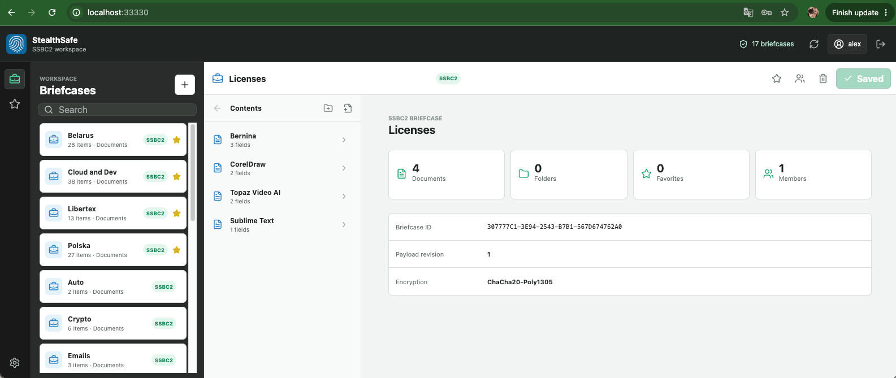
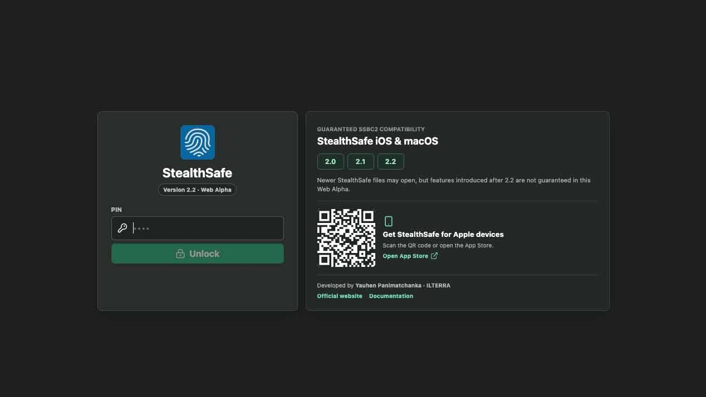
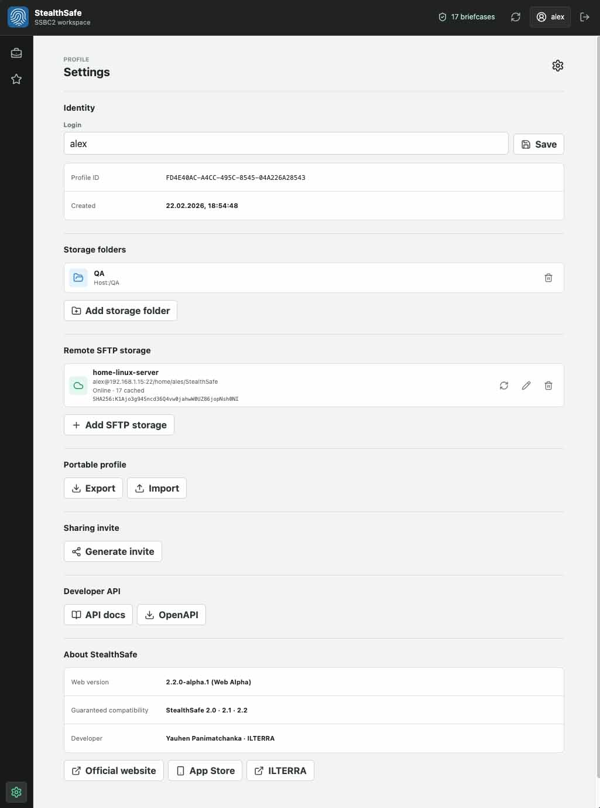
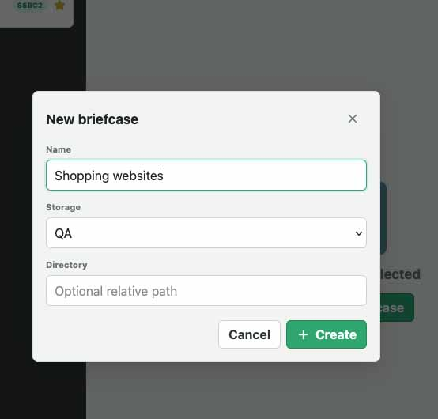
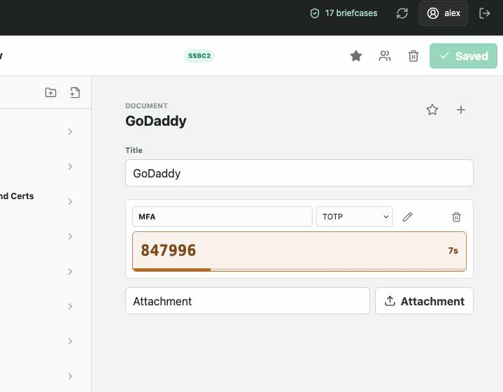

StealthSafe Docker edition brings the StealthSafe encrypted briefcase model to desktops, private servers, workstations, NAS-style environments, and automation-friendly infrastructure.

It is designed for people who want direct control over where private data is stored, and for technical users who want a local API for secure storage workflows.

## Core Ideas

### Profile

A profile is unlocked with a PIN. If the PIN matches an existing profile, StealthSafe opens it. If it does not match an existing profile, StealthSafe creates a new profile automatically.

Keep your PIN safe. It is part of how you access your encrypted data.

### Briefcase

A briefcase is an encrypted `.ssbc2` file. It can contain folders, documents, fields, attachments, private notes, passwords, one-time code fields, and other confidential records.

Briefcases can be stored in local folders, cloud-synchronized folders, removable drives, or server-mounted locations that you expose to the Docker containers.

### Storage Folder

A storage folder is a folder selected inside the active StealthSafe profile. StealthSafe scans selected storage folders for `.ssbc2` briefcases and offers them when creating new briefcases.

Docker mounts make host folders visible to the containers. Storage folders tell StealthSafe which of those visible folders should actually be used.

### Documents And Fields

Inside a briefcase, you can create folders and documents. Documents can contain different field types, such as text, passwords, URLs, notes, one-time code fields, and attachments.

This gives you a structured way to store private information instead of keeping everything in a single flat list.

> <figure class="figure"></figure>

## Why Use The Docker Edition

### It Runs Where You Work

The Docker edition can run on Windows, macOS, Linux, private servers, NAS-like systems, homelabs, and internal infrastructure hosts. If the environment supports Docker, it can usually run StealthSafe.

### It Uses Storage You Control

You decide where encrypted briefcases live. Keep them in a local folder, a cloud-synchronized folder, a mounted network share, or a server directory.

### It Works With The Apple App

The Docker edition is compatible with the SSBC2 briefcase format used by StealthSafe iOS and macOS versions 2.0, 2.1, and 2.2. This makes it possible to use the Apple app for mobile access and the Docker edition for desktop or server work.

### It Supports More Advanced Workflows

The backend includes API documentation. Engineers can use it to connect StealthSafe to internal tools, dashboards, scripts, or controlled server workflows.

### It Avoids Mandatory Vendor Storage

StealthSafe does not force your records into a developer-operated cloud. You can combine local-first encryption with the storage and backup model you trust.

## First Launch

1. Start the Docker edition with the launcher script for your operating system.
2. Open `http://localhost:33330`.
3. Enter a PIN.
4. Let StealthSafe open the matching profile or create a new one automatically.
5. Open Settings and add at least one storage folder.

> <figure class="figure"></figure>

## Adding Storage Folders

> <div class="cols" markdown="1">
>
> <div class="col v-center" markdown="1">
>
> After unlocking, open **Settings -> Storage folders**.
>
> You will see folders made available through Docker mounts. Select the exact nested folder where StealthSafe should store and scan encrypted briefcases.
>
> Good examples:
>
> - A dedicated local folder such as `Documents/StealthSafe`.
> - A cloud-synchronized folder such as an iCloud Drive or Google Drive folder.
> - A mounted network share for a private server or team environment.
> - A project-specific directory for engineering workflows.
>
> </div>
>
> <div class="col" markdown="1">
>
> <figure class="figure"></figure>
>
> </div>
>
> </div>

## Creating A Briefcase

> <div class="cols" markdown="1">
>
> <div class="col v-center" markdown="1">
>
> <figure class="figure wide"></figure>
>
> </div>
>
> <div class="col v-center" markdown="1">
>
> 1. Open the briefcase list.
> 2. Choose the action to create a new briefcase.
> 3. Select the storage folder where the `.ssbc2` file should be saved.
> 4. Give the briefcase a clear name.
> 5. Save it.
>
> Use separate briefcases for separate areas of life or work. For example, you might keep personal records, client data, infrastructure access, travel documents, and family information in different briefcases.
>
> </div>
>
> </div>

## Working With Documents

Inside a briefcase, create folders and documents to keep information organized.

> <div class="cols" markdown="1">
>
> <div class="col" markdown="1">
>
> Typical document examples:
>
> - Account record with login, password, URL, notes, and attachment.
> - Server access record with host, username, access notes, and recovery instructions.
> - Private document record with encrypted file attachments.
> - One-time code record where the current code is visible, while the underlying secret is not shown in normal view mode.
>
> Use edit mode only when you need to change field values.
>
> </div>
>
> <div class="col" markdown="1">
>
> <figure class="figure wide"></figure>
>
> </div>
>
> </div>

## One-Time Code Fields

One-time code fields are designed for quick authentication workflows. In normal view mode, StealthSafe should show the current code and timing indicator without exposing the underlying secret value.

When the code is close to expiring, refresh timing helps you avoid copying a code that will become invalid too soon.

## Attachments

Documents can include encrypted attachments. Use attachments for files that belong with a record, such as PDFs, certificates, screenshots, recovery documents, or small configuration files.

Because attachments increase briefcase size, keep large files organized and make sure your chosen storage folder has enough space and reliable backups.

## Sharing And Profile Portability

StealthSafe is built around cryptographic access to briefcases. When supported by the active version, briefcases can include access for more than one profile.

Use sharing features carefully:

- Share only with profiles you trust.
- Keep exported profile configuration files private.
- Store backup materials somewhere safe.
- Remove access when it is no longer needed.

## Using Cloud Or Network Storage

StealthSafe can work with folders synchronized by cloud providers or mounted from network storage.

Examples:

- iCloud Drive for Apple ecosystem synchronization.
- Google Drive or OneDrive for desktop synchronization.
- Samba/SMB folders mounted by the host operating system.
- NAS folders mounted on a workstation or server.

The important rule is simple: mount the folder into Docker first, then select the folder inside StealthSafe settings.

## API Usage

Open API documentation at:

```
http://localhost:33330/docs
```

The API can be useful for:

- Internal tools that need controlled access to encrypted records.
- Server workflows that need a local secret storage layer.
- Automation around briefcase discovery, creation, and updates.
- Custom interfaces built on top of the StealthSafe backend.

## Safety Tips

- Keep your PIN private.
- Back up encrypted briefcase files.
- Back up exported profile configuration if you use portability or sharing.
- Do not expose the web UI or backend API directly to the public internet without an additional access-control layer.
- Use narrow Docker mounts when possible. Mount only the folders StealthSafe really needs.
- Let cloud synchronization finish before editing the same briefcase from another device.
- Use demo data in screenshots, tutorials, and support requests.

## Best Use Cases

### Personal Secure Storage

Keep private records, passwords, notes, documents, and recovery information in encrypted briefcases controlled by you.

### Desktop Companion To The Apple App

Use the App Store version on iPhone and iPad, and use Docker on desktop for larger-screen editing and file management.

### Private Server Storage

Run StealthSafe on a trusted host and mount server-side folders for centralized encrypted briefcase storage.

### Engineering And Operations Workflows

Use the API to integrate StealthSafe with internal tools, project environments, and controlled automation.

## Compatibility Note

StealthSafe Docker edition version 2.2 Web Alpha is designed for SSBC2 compatibility with StealthSafe iOS and macOS versions 2.0, 2.1, and 2.2.

Newer briefcases may open, but features introduced in later mobile versions may require a Docker edition update.
