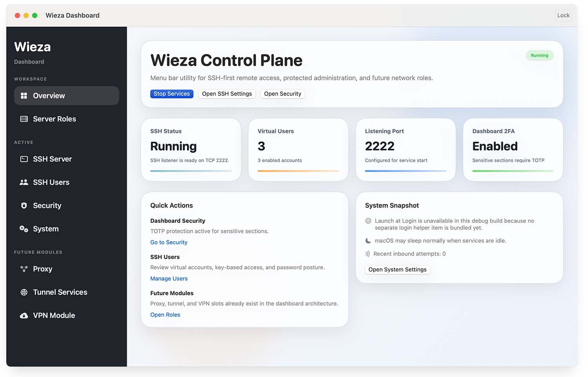
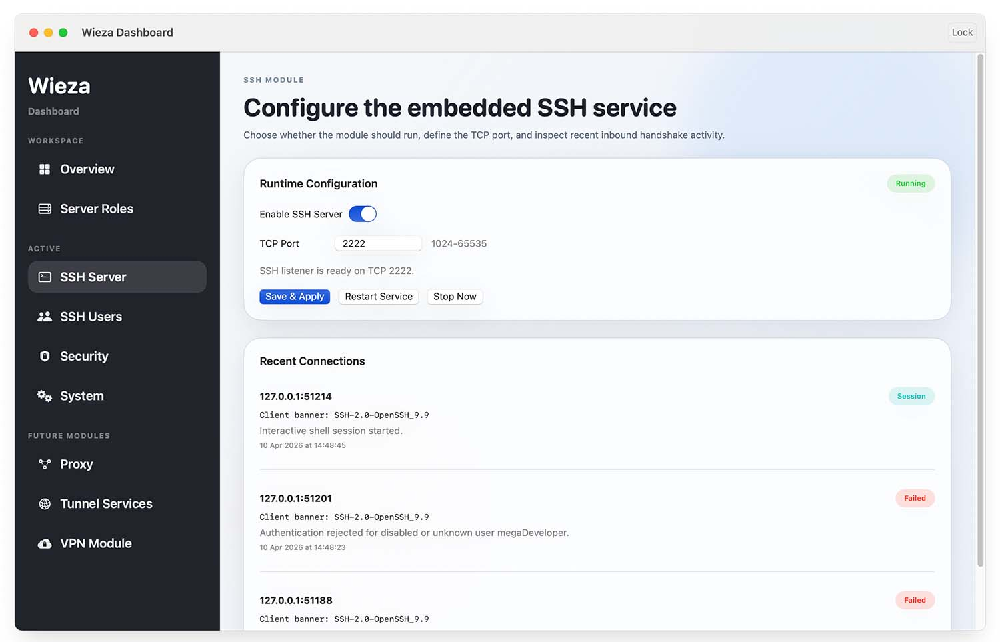
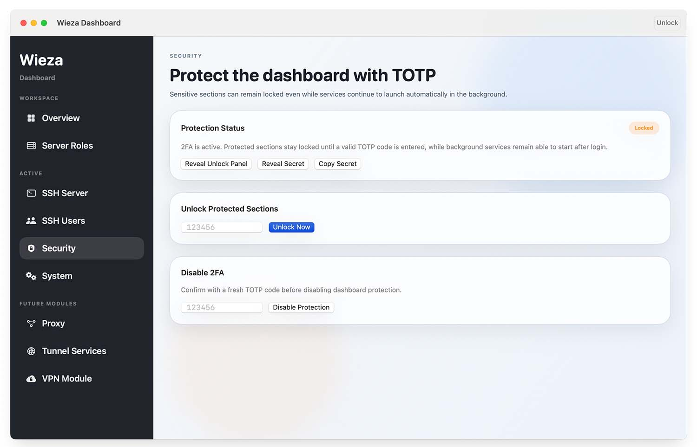

## Turn Your Mac into a Managed Remote Access Workspace

Wieza is a menu bar utility for macOS with its own embedded SSH server, a dedicated admin dashboard, and support for virtual SSH users. It is built for the moments when the built-in macOS SSH server is either too limited, too inconvenient, or simply not flexible enough for the way real teams work.

Instead of sharing one local macOS account with multiple people, rotating system passwords, and manually juggling access every time someone joins or leaves a workflow, Wieza gives you a cleaner model: create separate logical SSH users inside the app, assign each of them their own credentials, and let them connect to the same Mac through their own identity.

That means one machine can remain one real working environment, while access is distributed in a more controlled, understandable, and manageable way.

> 
<a class="btn" href="https://drive.google.com/file/d/1pGG_wceZe97Bzj6BthE7Ca2_A29FmAmi" target="_blank" rel="noopener">Download Wieza (v. 1.0)</a>

**for MacOS** (dmg, for Intel and Apple Silicon processors)
{: .text-center .text-accent }

<figure class="figure text-center"><figcaption>Dashboard screen of the Wieza application</figcaption></figure>

## Why Not Just Use the Built-In macOS SSH Server?

The built-in SSH server in macOS works well for a very basic setup: a Mac, one or more real local system accounts, and a standard Remote Login workflow. But once a machine becomes part of a shared workflow, the pain points start to show very quickly.

You may need to:

- give access to several people without creating a separate full macOS account for each of them;
- revoke one person’s access without changing the local password of the host machine;
- separate SSH identities by person, team role, or credential set;
- manage access from a dedicated dashboard instead of jumping through system settings;
- protect server administration with an additional factor;
- build toward future auditing, proxying, tunneling, and other network roles from one place.

Wieza is designed for exactly that layer of work. It does not try to replace macOS. It adds a more practical and more manageable access layer on top of it.

## What Makes Wieza Valuable Today

### Multiple Virtual SSH Users on Top of One Mac

With Wieza, you can create multiple SSH users inside the application itself. Each one can have:

- its own username;
- its own password;
- its own public keys;
- its own authentication mode;
- its own enabled or disabled state.

This makes it possible to let several operators, developers, teammates, or temporary collaborators connect to the same machine without sharing the password of the local macOS account.

In practice, this is useful when:

- one powerful Mac is used as a shared build host;
- a teammate needs temporary shell access;
- you want access to be issued quickly and revoked just as quickly;
- you want each remote login to use its own credentials instead of one shared account.

### Revoke Access Without Touching the Local System Password

One of the most frustrating parts of traditional shared access is what happens when one person should no longer be allowed in. If everyone effectively depends on the same local account, revoking access often means changing system-level credentials and then dealing with the fallout.

Wieza avoids that. If a specific person should lose access, you can disable or remove that specific virtual SSH user inside the dashboard. The local macOS user remains untouched. The host machine’s password does not need to be rotated just because one remote identity is no longer valid.

That makes access:

- easier to manage;
- safer to distribute;
- less disruptive for the owner of the machine;
- far more practical in shared environments.

### A Dedicated Dashboard for Operational Control

Wieza comes with its own dashboard, so you are not forced to manage your remote access workflow entirely through hidden settings or manual terminal-only configuration on the host machine.

From the dashboard, you can:

- start and stop the SSH service;
- configure the listening port;
- review recent inbound connections;
- create and edit virtual users;
- choose how each user authenticates;
- manage key security settings.

That makes the machine feel less like a box you have to manually patch together and more like a controlled, understandable remote access node.

<figure class="figure"></figure>

### Protect Administrative Settings with MFA

Remote access is not only about who can log in over SSH. It is also about who can change the server itself.

That is why Wieza includes support for TOTP-based MFA on the admin side. Sensitive operations can be protected behind an additional factor, including:

- issuing new access;
- revoking access;
- changing server settings;
- modifying sensitive configuration values.

This gives the person who manages the host machine a much stronger control boundary. Even if the Mac is shared physically or used in a broader team environment, the admin plane of Wieza can remain protected by a code known only to the owner or administrator.

<figure class="figure"></figure>

## Real-World Use Cases

### A Shared Team Mac

If you have one Mac mini, Mac Studio, or MacBook serving as a shared machine for several people, Wieza turns it into a more manageable and more structured point of access. You keep one real host environment, but access itself becomes easier to distribute and easier to control.

### A Build Host for Apple Development

Teams building software for Apple platforms often rely on one or more dedicated Macs for builds, signing, automation, and tooling. In these setups, access to the machine often needs to be shared across multiple engineers. Wieza makes that workflow much cleaner by separating remote credentials without forcing the team to redesign the entire local user model of the Mac.

### Temporary Access Without Rebuilding the Entire System

Sometimes you only need to give someone access for a short period of time. In those cases, you may not want to:

- create a full local system user;
- share your own macOS password;
- clean up system-level configuration later.

Wieza gives you a lighter-weight alternative. You can create a virtual access identity, give the person what they need, and remove it when the job is done.

### Situations Where Built-In Remote Login Is Restricted or Inconvenient

There are environments where the built-in SSH service in macOS is unavailable, disabled, or simply impractical for a specific workflow. In those cases, Wieza can serve as an application-level SSH access point with its own management layer and its own user model.

It is especially useful in scenarios where people want the convenience of reaching their Mac remotely, running builds, pulling files, or using terminal workflows from another laptop or workstation, without depending entirely on the built-in macOS path.

## Designed for Everyday Use, Not Just One-Time Setup

Wieza is meant to be practical in day-to-day work.

You get:

- a menu bar presence;
- quick access to the dashboard;
- one-click service control;
- a visible service state;
- access management without constant manual editing of host-level configuration;
- a foundation for turning one Mac into a broader remote access node over time.

That matters because many people do not want remote access to feel like a fragile internal system project. They want a tool they can open, understand, configure, and trust.

## A Better Access Layer for Shared Machines

At its core, Wieza solves a simple but important problem: one Mac often needs to serve more than one person, but standard approaches do not always provide a clean operational model for that.

With Wieza, one machine can remain one real machine, while access becomes:

- individually issued;
- individually revocable;
- easier to understand;
- easier to secure;
- easier to evolve.

This is especially valuable when you want multiple remote identities without the overhead and complexity of turning every remote person into a full local macOS account.

## Where Wieza Is Going Next

Wieza already solves a real and immediate problem today with embedded SSH access, virtual users, and a protected administrative dashboard. But the long-term vision goes much further.

Wieza is being shaped as a broader remote access and network utility for macOS that can eventually grow into additional roles such as:

- VPN services;
- proxy services;
- tunneling services;
- richer auditing and session visibility;
- more detailed access control;
- a more unified operational surface for remote connectivity on a Mac.

The goal is not just to expose a port. The goal is to make a Mac more useful as a controlled, flexible, multi-purpose remote node without forcing users to stitch together a stack of unrelated tools.

## Why This Matters

Modern remote work is not just about “turning on SSH.”

It is about being able to:

- give access quickly;
- remove access quickly;
- avoid sharing system passwords;
- keep administrative control protected;
- support real-world collaboration;
- expand capabilities over time without rebuilding everything from scratch.

That is what Wieza is built to deliver: not just SSH access, but a more manageable remote access model for a real working macOS environment.

## Download Wieza

If you want a cleaner way to turn your Mac into a controlled SSH access point for multiple people, Wieza is built for exactly that.

> 
<a class="btn" href="https://drive.google.com/file/d/1pGG_wceZe97Bzj6BthE7Ca2_A29FmAmi" target="_blank" rel="noopener">Download Wieza (v. 1.0)</a>

**for MacOS** (dmg, for Intel and Apple Silicon processors)
{: .text-center .text-accent }
